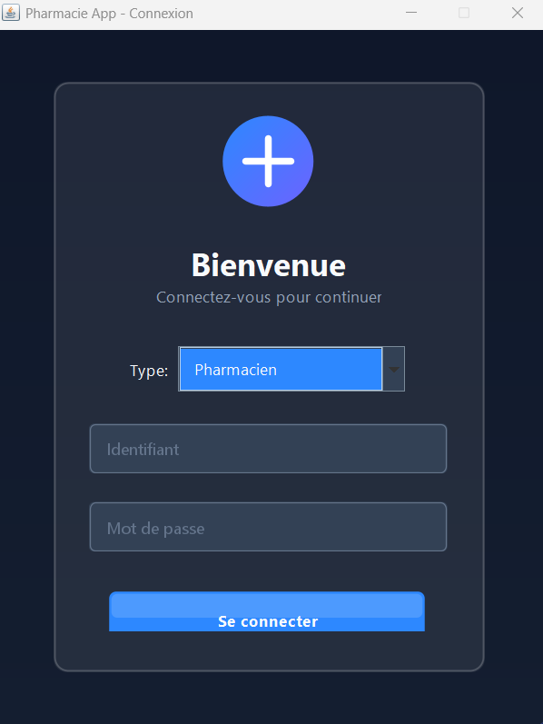
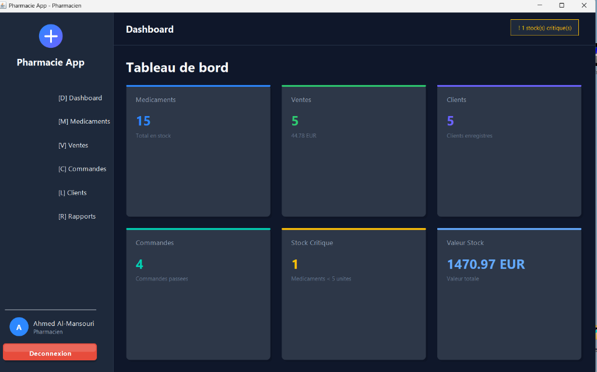

# Pharmacie App

Application desktop de gestion de pharmacie developpee en Java avec Swing et MySQL.



## Apercu

Pharmacie App centralise les operations quotidiennes d'une officine :

- authentification distincte des pharmaciens et gestionnaires ;
- tableau de bord avec indicateurs principaux ;
- gestion des medicaments et du stock ;
- enregistrement et annulation des ventes ;
- gestion des clients ;
- creation et suivi des commandes ;
- consultation de l'historique du stock ;
- alertes pour les stocks critiques ;
- rapports sur les ventes, les stocks et les clients.



## Roles

### Pharmacien

- consulter le dashboard ;
- gerer les medicaments et les quantites ;
- enregistrer une vente ;
- annuler une vente ;
- consulter les ventes ;
- creer et consulter les commandes ;
- consulter l'historique ;
- afficher les rapports.

### Gestionnaire

- consulter le dashboard ;
- gerer les medicaments et les stocks ;
- gerer les clients ;
- creer et suivre les commandes ;
- consulter les rapports.

## Technologies

| Composant | Technologie |
|---|---|
| Langage | Java |
| Interface graphique | Swing |
| Base de donnees | MySQL |
| Connecteur | MySQL Connector/J 8.0.33 |
| IDE | Visual Studio Code / Java |

## Structure du projet

```text
Gestion d'une Pharmacie/
|-- src/
|   |-- LoginGUI.java
|   |-- MainGUI.java
|   |-- DBConnection.java
|   |-- Medicament.java
|   |-- Vente.java
|   |-- Commande.java
|   |-- Client.java
|   |-- StockHistorique.java
|   |-- Pharmacien.java
|   |-- Gestionnaire.java
|   |-- PharmacieTheme.java
|   `-- Notification.java
|-- lib/
|   `-- mysql-connector-j-8.0.33.jar
|-- Rapport/
|   |-- Rapport_Projet.html
|   |-- login_screen.png
|   `-- dashboard_screen.png
|-- schema.sql
|-- run.bat
|-- run.ps1
`-- README.md
```

## Prerequis

- Java JDK 8 ou superieur ;
- MySQL Server ;
- MySQL Connector/J inclus dans le dossier `lib/` ;
- Swing disponible dans l'environnement Java.

Verifier Java :

```powershell
java -version
javac -version
```

## Installation

### 1. Initialiser la base de donnees

Ouvrir MySQL et executer le script :

```sql
SOURCE C:/chemin/vers/Pharmacie/schema.sql;
```

Le script cree la base `gestion_pharmacie`, les tables necessaires et des donnees de demonstration.

### 2. Configurer l'acces MySQL

Les valeurs par defaut sont `localhost:3306`, utilisateur `root` et mot de passe vide.

Pour utiliser vos propres identifiants sous Windows PowerShell :

```powershell
$env:DB_URL = "jdbc:mysql://localhost:3306/gestion_pharmacie"
$env:DB_USER = "root"
$env:DB_PASSWORD = "VotreMotDePasse"
```

Vous pouvez egalement modifier les valeurs par defaut dans `src/DBConnection.java`.

### 3. Compiler le projet

```powershell
javac -cp "lib/mysql-connector-j-8.0.33.jar" -d bin (Get-ChildItem src/*.java).FullName
```

Sous Windows, un script automatise est aussi disponible :

```bat
run.bat
```

## Demarrage

Lancer l'application graphique :

```powershell
java -cp "bin;lib/mysql-connector-j-8.0.33.jar" LoginGUI
```

Ou avec PowerShell :

```powershell
$classpath = "bin;lib/mysql-connector-j-8.0.33.jar"
java -cp $classpath LoginGUI
```

## Comptes de demonstration

| Role | Identifiant | Mot de passe |
|---|---|---|
| Pharmacien | p1 | 123 |
| Pharmacien | p2 | 456 |
| Gestionnaire | g1 | 111 |
| Gestionnaire | g2 | 222 |

Ces comptes sont crees automatiquement par `schema.sql`.

## Modele de donnees

La base comprend les entites suivantes :

- `Pharmacien`
- `Gestionnaire`
- `Client`
- `Medicament`
- `Vente`
- `Commande`
- `StockHistorique`

## Rapport du projet

Le rapport HTML complet contenant les captures et l'analyse technique est disponible dans [Rapport/Rapport_Projet.html](Rapport/Rapport_Projet.html).

## Compilation rapide

`run.bat` compile automatiquement les fichiers Java, puis lance `LoginGUI`.

## Securite

- ne pas integrer de mot de passe MySQL dans le depot ;
- privilegier les variables d'environnement `DB_USER` et `DB_PASSWORD` ;
- remplacer les mots de passe des comptes de demonstration avant toute utilisation reelle ;
- restreindre les privileges du compte MySQL utilise par l'application.

## Auteur

Projet realise dans le cadre d'une application de gestion de pharmacie.
